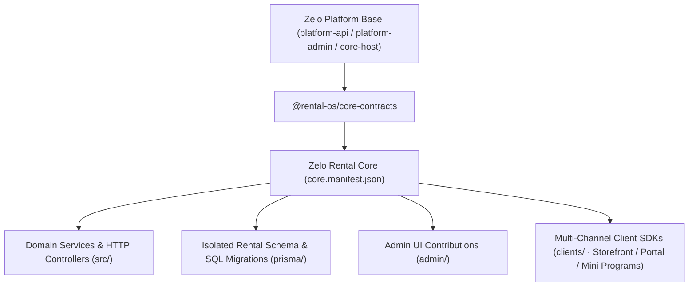

# Zelo Rental Core

<picture>
  <source media="(prefers-color-scheme: dark)" srcset="https://raw.githubusercontent.com/JinPen-G/Zelo/main/assets/01_Logo/zelo-logo-bw/zelo-logo-white.svg">
  
</picture>

**The first official production business Core for [Zelo](https://github.com/JinPen-G/Zelo) — a standalone, multi-category rental SaaS package and complex vertical Core reference implementation.**

*开源多租户 SaaS 底座 [Zelo](https://github.com/JinPen-G/Zelo) 的首个官方生产级业务 Core —— 覆盖多品类租赁全链路的独立业务包与架构参考实现。*

[](LICENSE)
[](core.manifest.json)
[](https://github.com/JinPen-G/Zelo)
[](core.manifest.json)
[](package.json)
[](https://github.com/topics/zelo-core)

[简体中文](README.md) | **English**

---

**Zelo Rental Core** (`@rental-os/rental-core`) is the first full-featured vertical business Core built on top of the open-source multi-tenant SaaS foundation **[Zelo](https://github.com/JinPen-G/Zelo)**. It packages complete rental operations—catalog, assets & inventory, multi-strategy pricing, quotes & bookings, dispatch & handover, return inspection & exchanges, billing & payment reconciliation, and personal/enterprise membership credit—into a **self-contained standard Core package** that installs and upgrades independently of the Zelo base.

> **Quick Navigation**: [Business Capabilities](#core-business-capabilities) · [Architecture & Compatibility](#architecture--compatibility) · [Installation & Discovery](#quick-installation--discovery) · [Build & Release](#build-development--release) · [Repository Structure](#repository-structure--module-guide) · [HTTP API & OpenAPI](#http-api--openapi) · [Legacy Adoption & Recovery](#legacy-adoption--recovery) · [Build Your Own Core](#build-your-own-core--monetize-extensions) · [License](#license--contributing)

---

## Core Business Capabilities

Rental Core enforces two-tier tenant and workspace (`rental-workspace`) isolation, natively supports **photography gear, camping equipment, vehicles, and construction machinery** through category capabilities, and runs cleanly in both **standard non-AI mode** and **optional governed AI Native / MCP mode**:

| Domain | Capabilities Covered | Module Guide |
| --- | --- | --- |
| **Catalog, Assets & Inventory** | Item/kit catalog, serialized & quantity inventory, asset status history, stock operations & disposition recovery, media assets | [Catalog Admin](admin/catalog/README.md) · [Core Facts Repo](src/mysql-core-facts.ts) |
| **Pricing, Promotions & Capacity** | Time/usage/tiered/capped pricing strategies, frozen price snapshots, discount plans, coupons, add-on services & business calendars | [Commercial Admin](admin/commercial/README.md) · [Pricing Engine](src/pricing.ts) |
| **Quotes, Orders & Fulfillment** | Immutable quote snapshots, order confirmation & merchant delegation, allocation & reassignment, pickup/return/extension/exchange workflows, maintenance work orders | [Orders Admin](admin/orders/README.md) · [Work Orders](admin/work-orders/README.md) |
| **Memberships & Enterprise Accounts** | Tenant-shared customer master, personal membership plans & rewards, registration/qualification reviews, corporate credit & monthly settlement, enterprise portal & approval handoffs | [Membership Admin](admin/membership/README.md) · [Enterprise Portal SDK](clients/enterprise-portal/README.md) |
| **Finance & Payment Reconciliation** | Order bills, refundable deposits & pre-authorizations, staff offline payment recording/confirmation, payment/refund webhooks, batch reconciliation & variance resolution | [Reconciliation Admin](admin/payment-reconciliation/README.md) · [Payment Runtime](src/mysql-payment-runtime.ts) |
| **Category, Rules & Channel Governance** | Workspace category version adoption, capability governance, store opening readiness setup, fulfillment locations, storefront & WeChat Mini Program channels | [Governance Admin](admin/governance/README.md) · [Channels](admin/channels/README.md) · [Setup](admin/setup/README.md) |
| **Operations Workbench & Client SDKs** | Operational overview, analytics reports & CSV export; ships reusable client SDKs for storefront, enterprise portal, and customer/staff WeChat Mini Programs | [Operations Admin](admin/operations/README.md) · [Client SDKs](#repository-structure--module-guide) |
| **Optional AI Native & MCP** | Zero AI required for standard business flows; when enabled, shares Zelo's unified Model Gateway, approval linkage, original-receipt reconciliation & governed MCP | [AI Business Sources](src/application-ai-sources.ts) · [AI Assistant UI](admin/assistant/README.md) |

---

## Architecture & Compatibility

Rental Core owns only rental domain logic, raw SQL migrations, HTTP controllers, admin UI contributions, and client SDKs; accounts, multi-tenancy, org RBAC, subscriptions, encrypted integrations, and the shared admin shell come straight from the **[Zelo Platform Base](https://github.com/JinPen-G/Zelo)**.



### Current Release & Compatibility Matrix

| Item | Current Value / Requirement | Notes |
| --- | --- | --- |
| **Core ID / Version** | `rental` · `0.1.14` | Standard `.tgz` packages published on [GitHub Releases](https://github.com/JinPen-G/Zelo-rental-core/releases) |
| **Compatible Zelo Base** | `>=0.1.12 <0.2.0` | Verified against [Zelo Base `0.1.17`](https://github.com/JinPen-G/Zelo/releases/tag/v0.1.17) |
| **Core Contract Range** | `>=0.1.1 <0.2.0` | Validated via `@rental-os/core-contracts` |
| **Runtime Requirements** | Node.js `>=22.12.0 <25.0.0` · MySQL 8.4 | Matches the Zelo platform base |
| **Data Version & Migrations** | `dataVersion: 0.1.1` (2 raw SQL migrations) | Initial rental schema + `0.1.13` 6-table exchange workflow; see [Data Upgrade Notes](prisma/README.md#迁移与历史) |
| **Discovery Topic** | `zelo-core` | Discoverable directly inside Zelo `/platform/core-packages` |
| **License** | MIT License | [LICENSE](LICENSE) |

> **Release & Renaming Notes**:
> - `0.1.14` restores original quote-total theme tokens in the standalone admin UI with no new database migrations relative to `0.1.13`; `0.1.13` adds 6 exchange-workflow tables (existing deployments must apply the appended migration before booting `0.1.13+`; see [prisma/README.md](prisma/README.md#迁移与历史)).
> - The public repository is now **`Zelo-rental-core`**. Clone and support URLs use the new name. The `0.1.14` discovery manifest and published archives retain the original `https://github.com/JinPen-G/nativark-rental-core` source identity and pinned commit. A repository redirect does not change an installed deployment lock; a future source change requires an explicit migration plan.

---

## Development source and published releases

The current source includes the domain fixes from Zelo commit `6587e178ea36a50195e7f61e13bb5a7387bbd95b`, plus the independent repository’s logout cancellation and controlled receipt-read fixes. These changes have not been issued as a new release. Version `0.1.14`, its manifest, tags and archives continue to identify the published release. New artifacts require a new version and a pinned host combination.

The changes cover transaction-bound quote configuration checks, client order-creation participants, fresh inventory and asset references, cold-instance reads, and website catalog validation. See the [current Chinese integration notes](README.md#本批接入变化) and [fixed detailed developer guide](https://github.com/JinPen-G/Zelo-rental-core/blob/8902e4d8db920cf33fd54992ec2cb939150985f0/README.md#阅读路线).

## Quick Installation & Discovery

Package staging, deployment registration, tenant grants, and member assignments are managed cleanly in Zelo without editing base source code. See [CORE_GUIDE.md](CORE_GUIDE.md) and Zelo's [5-Step Core Integration Guide](https://github.com/JinPen-G/Zelo/blob/main/README.en.md#integrate-your-business-core-in-5-steps).

### Option 1: Online Discovery via Zelo Admin Console (Recommended)

1. Boot a compatible [Zelo Zero-Core Base](https://github.com/JinPen-G/Zelo/blob/main/README.en.md#3-option-a-run-the-pure-zero-core-base-recommended) and sign in as SaaS admin.
2. Open **`/platform/core-packages` → Discover Cores**, search `rental`, or enter `JinPen-G/Zelo-rental-core`.
3. Inspect the pinned manifest, compatibility range, and Release SHA-256 digest, then stage the candidate package.
4. Apply migrations, update the deployment lock, and boot the host following the [Rental Standalone API Host Guide](https://github.com/JinPen-G/Zelo/blob/main/apps/rental-api/README.md).
5. Grant `rental` to target tenants in `/platform/core-access`, then assign members and domain roles in `/settings/member-cores`.

### Option 2: CLI Release Inspection

From a Zelo source checkout with `@rental-os/core-contracts` built:

```bash
npm run build -w @rental-os/core-contracts

# 1. Discover public repositories tagged with zelo-core
node packages/core-contracts/dist/github-release.js discover rental

# 2. Inspect pinned repository manifest & release status
node packages/core-contracts/dist/github-release.js repository JinPen-G/Zelo-rental-core --releases

# 3. Pin a specific release and its SHA-256 digest
node packages/core-contracts/dist/github-release.js inspect JinPen-G/Zelo-rental-core rental <version>
```

---

## Build, Development & Release

Rental Core builds inside a combined workspace pairing a pinned Zelo base support commit with this repository:

- **Server Assembly**: Mount via `RentalHttpModule` (`@rental-os/rental-core/http`) and the [full application factory](src/application.ts).
- **Admin UI Assembly**: Call `createRentalAdminContribution(version, contexts)` from [admin/index.tsx](admin/index.tsx) inside the Zelo admin shell.
- **Prisma & SQL Migrations**: Compose isolated rental models and raw SQL migrations via [src/data.ts](src/data.ts) and [prisma/README.md](prisma/README.md) (`rental` 162 models without AI, or `rental-ai` 248 models with AI enabled).

Inside a prepared workspace root, point `RENTAL_PRISMA_CLIENT` to the host's generated client declaration to compile and type-check this package:

```powershell
# PowerShell (use export RENTAL_PRISMA_CLIENT=... in Bash)
$env:RENTAL_PRISMA_CLIENT = (Resolve-Path 'apps/rental-api/generated/client/index.d.ts').Path
npm run build -w @rental-os/rental-core
npm run lint -w @rental-os/rental-core
```

### Preparing a Standalone Dev Workspace

Use Zelo's [prepare-rental-workspace.cjs](https://github.com/JinPen-G/Zelo/blob/68303f7abedc8c70540662f70e268eacb132e2a1/scripts/prepare-rental-workspace.cjs) script to combine the pinned Zelo base support commit (`68303f7abedc8c70540662f70e268eacb132e2a1`) with a tagged commit from this repository into a reproducible dev archive:

```bash
# Run from the Zelo support commit root (after npm ci --ignore-scripts && npm run build -w @rental-os/core-contracts)
node scripts/prepare-rental-workspace.cjs \
  --repo <zelo-base-git-dir> \
  --repository https://github.com/JinPen-G/Nativark \
  --commit 68303f7abedc8c70540662f70e268eacb132e2a1 \
  --core-repo <zelo-rental-core-git-dir> \
  --core-commit <tag-commit-sha> \
  --out rental-dev-workspace.tgz
```

Unpack the archive, run `npm ci` and `npm run check:types`, and run `npm run check:core` after editing `packages/rental-core` (pass `--ai` to enable optional AI Native development).

### Packaging a Standard Core Release

Build a portable `.tgz` Core artifact (`core.manifest.json`, compiled entrypoints, portable OpenAPI, `CORE_GUIDE.md`, `README.md`, `LICENSE`, and raw SQL migrations) and optional Linux Docker host bundle:

```bash
# 1. Build a portable standard Core package
node scripts/verify-rental-distribution.cjs --portable \
  --build-repo <zelo-base-git-dir> \
  --commit <build-sha> \
  --platform-commit <base-sha> \
  --source-repository https://github.com/JinPen-G/Nativark \
  --core-repo <zelo-rental-core-git-dir> \
  --core-commit <tag-commit-sha> \
  --out <output-dir/rental-version.tgz>

# 2. Optionally package a standalone Linux Docker host context (--ai disabled | enabled)
node scripts/package-rental-host.cjs \
  --ai disabled \
  --deployment <prepared-deployment-dir> \
  --platform-package <pinned-base-tgz-abs-path> \
  --rental-package <pinned-rental-package-dir> \
  --client <apps/rental-api/generated/client/index.d.ts> \
  --platform-client <apps/platform-api/generated/client/index.d.ts> \
  --output <output-host-archive-abs-path.tgz>
```

When cutting a new release: tag `v<version>`, attach `rental-<version>.tgz` and `SHA256SUMS` to a non-prerelease GitHub Release, update root `core.manifest.json` and `CORE_GUIDE.md`, and keep the repository tagged with **`zelo-core`**.

---

## Repository Structure & Module Guide

```text
Zelo-rental-core/
├── core.manifest.json          # Standard Core discovery manifest (ID, version, compatibility, permissions, migrations, assets)
├── CORE_GUIDE.md               # Generated 5-step integration & AI coding agent guide
├── package.json                # @rental-os/rental-core package definition & fine-grained subpath exports
├── prisma/                     # Isolated rental Prisma schema & raw SQL migration chain
├── src/                        # Domain services, MySQL repositories, HTTP controllers, OpenAPI & package factory
├── admin/                      # Admin UI page contributions (catalog, orders, commercial, membership, workbench, AI, etc.)
├── clients/                    # Multi-channel SDKs (storefront, enterprise portal, customer & staff WeChat Mini Programs)
└── test/                       # Offline contract, legacy access preparation, and adoption regression tests
```

### Module Entrypoints

| Layer | Directory & Guide Links |
| --- | --- |
| **Schema & Migrations** | [Prisma Schema & Upgrade Notes](prisma/README.md) · [Data Release & Checksums](src/data.ts) |
| **Application & Core Runtime** | [Application Composition](src/application.ts) · [HTTP Module](src/http.module.ts) · [Manifest Factory](src/manifest.ts) · [Package Factory](src/package.ts) |
| **Admin UI Pages** | [Admin Overview](admin/README.md) · [Unified Contribution](admin/index.tsx) · [Browser Session](admin/browser/README.md) · [Catalog](admin/catalog/README.md) · [Orders](admin/orders/README.md) · [Commercial](admin/commercial/README.md) · [Membership](admin/membership/README.md) · [Operations](admin/operations/README.md) · [Governance](admin/governance/README.md) · [Work Orders](admin/work-orders/README.md) · [Locations](admin/locations/README.md) · [Capabilities](admin/capabilities/README.md) · [Channels](admin/channels/README.md) · [Setup](admin/setup/README.md) · [Payment Reconciliation](admin/payment-reconciliation/README.md) · [AI Assistant](admin/assistant/README.md) · [Task Center](admin/task-center/README.md) · [Desktop Auth](admin/agent-desktop/README.md) |
| **Multi-Channel Client SDKs** | [Storefront SDK](clients/website/README.md) · [Storefront UI](clients/website-ui/README.md) · [Enterprise SDK](clients/enterprise/README.md) · [Enterprise Portal UI](clients/enterprise-portal/README.md) · [Customer Mini Program SDK](clients/miniprogram/README.md) · [Staff Mini Program SDK](clients/staff/README.md) |

---

## HTTP API & OpenAPI

`@rental-os/rental-core/http-openapi` exports `createRentalOpenApi()`, providing a `CoreOpenApiContribution` with **595 operations and 413 schemas** under the `rental.` namespace. Hosts merge it into `GET /api/openapi.json` via `composeCoreOpenApi`.

- **Source Modules**: [OpenAPI Contribution](src/http-openapi.ts) · [Operations](src/http-openapi-operations.ts) · [Schemas](src/http-openapi-schemas.ts) · [Portable Routes](src/http-portable.ts)
- **Export Standalone OpenAPI JSON Offline**:

```bash
node -e "const { createRentalOpenApi } = require('@rental-os/rental-core/http-openapi'); process.stdout.write(JSON.stringify(createRentalOpenApi(), null, 2))"
```

Every endpoint inherits Zelo's trusted authentication, tenant/workspace guards, transactional boundaries, and original-operation receipt semantics (`unknown` outcomes reconcile strictly against recorded receipts—never blind retries).

---

## Legacy Adoption & Recovery

Rental Core provides explicit server-side hooks for onboarding legacy tenants onto standard Core grants and safely inspecting records after Core disablement:

- **Read-Only Legacy Preparation & Single-Item Adoption**: Use [legacy-access-preparation.ts](src/legacy-access-preparation.ts) (`/legacy-access-preparation`) to diff existing tenants, workspaces, and roles, then apply individual tenant grants, member assignments, or bindings transactionally via [legacy-access-adoption.ts](src/legacy-access-adoption.ts) (`/legacy-access-adoption`) with original operation receipts and audit logs (tests: [preparation](test/legacy-access-preparation.test.cjs) · [adoption](test/legacy-access-adoption.test.cjs)).
- **Governed Post-Disablement Receipt Reads**: When Rental Core is disabled for new writes, controlled hosts can expose only the closed set of historical order, payment document, file evidence, and original-receipt read paths declared in [application-access.ts](src/application-access.ts), [application-recovery-policy.ts](src/application-recovery-policy.ts), and [application-recovery-authority.ts](src/application-recovery-authority.ts).

---

## Build Your Own Core & Monetize Extensions

Rental Core serves as the **first official blueprint** showing how a rich vertical SaaS product plugs cleanly into the Zelo multi-tenant base.

**We warmly invite developers, indie teams, and ISVs across industries to build more business Cores on Zelo**—using `Zelo-rental-core` (full vertical reference) and [Example Tickets Core](https://github.com/JinPen-G/Zelo/tree/main/packages/example-tickets-core) (minimal starter) as references for CRM, ERP, WMS, TMS, scheduling, education, healthcare, asset maintenance, retail chains, and more:

- **Instant Ecosystem Discovery**: Tag your public Core repo with **`zelo-core`** and attach a standard `.tgz` GitHub Release to appear directly inside `/platform/core-packages` on any Zelo deployment.
- **MIT-Friendly Commercialization**: Both Zelo and this Core are MIT-licensed. You retain complete control over your own Core's license and business model—open-source your base Core to grow adoption, and **freely sell paid extension modules, vertical add-ons, branded client apps, ERP/IoT connectors, or enterprise delivery services**.

---

## License & Contributing

- **License**: Original source code and documentation are released under the **[MIT License](LICENSE)**, allowing free commercial use, modification, and distribution with notice retention. Third-party UI archive references preserve their upstream licenses.
- **Contributing**: Issues and Pull Requests improving Rental Core are welcome! For platform-base discussions or building a new Core, visit **[JinPen-G/Zelo](https://github.com/JinPen-G/Zelo)** or follow the developer and AI agent workflow in [CORE_GUIDE.md](CORE_GUIDE.md).
- **Companion Repositories**: [Zelo Platform Base](https://github.com/JinPen-G/Zelo) · [Zelo Marketing Website](https://github.com/JinPen-G/Zelo-website)
