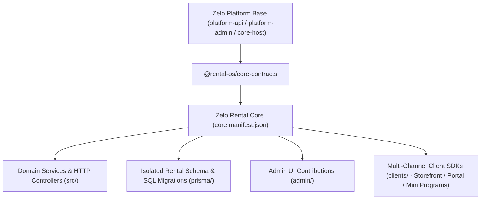

# Zelo Rental Core

**The first official production business Core for [Zelo](https://github.com/JinPen-G/Zelo) — a standalone, multi-category rental SaaS package and complex vertical Core reference implementation.**

*开源多租户 SaaS 底座 [Zelo](https://github.com/JinPen-G/Zelo) 的首个官方生产级业务 Core —— 覆盖多品类租赁全链路的独立业务包与架构参考实现。*

[](LICENSE)
[](https://github.com/JinPen-G/Zelo-rental-core/releases/tag/v0.2.1)
[](https://github.com/JinPen-G/Zelo)
[](core.manifest.json)
[](package.json)
[](https://github.com/topics/zelo-core)

[简体中文](README.md) | **English**

---

**Zelo Rental Core** (`@rental-os/rental-core`) is the first full-featured vertical business Core built on top of the open-source multi-tenant SaaS foundation **[Zelo](https://github.com/JinPen-G/Zelo)**. It packages complete rental operations—catalog, assets & inventory, multi-strategy pricing, quotes & bookings, dispatch & handover, return inspection & exchanges, billing & payment reconciliation, and personal/enterprise membership credit—into a **self-contained standard Core package** that installs and upgrades independently of the Zelo base.

> **Quick Navigation**: [Business Capabilities](#core-business-capabilities) · [Architecture & Compatibility](#architecture--compatibility) · [Installation & Discovery](#quick-installation--discovery) · [Build & Release](#build-development--release) · [Repository Structure](#repository-structure--module-guide) · [HTTP API & OpenAPI](#http-api--openapi) · [Legacy Adoption & Recovery](#legacy-adoption--recovery) · [Build Your Own Core](#build-your-own-core--monetize-extensions) · [License](#license--contributing)

---

## Core Business Capabilities

Rental Core enforces two-tier tenant and workspace (`rental-workspace`) isolation, natively supports **photography gear, camping equipment, vehicles, and construction machinery** through category capabilities, and runs cleanly in both **standard non-AI mode** and **optional governed AI Native / MCP mode**:

| Domain | Capabilities Covered | Module Guide |
| --- | --- | --- |
| **Catalog, Assets & Inventory** | Item/kit catalog, serialized & quantity inventory, asset status history, stock operations & disposition recovery, media assets | [Catalog Admin](admin/catalog/README.md) · [Core Facts Repo](src/mysql-core-facts.ts) |
| **Pricing, Promotions & Capacity** | Time/usage/tiered/capped pricing strategies, frozen price snapshots, discount plans, coupons, add-on services & business calendars | [Commercial Admin](admin/commercial/README.md) · [Pricing Engine](src/pricing.ts) |
| **Quotes, Orders & Fulfillment** | Immutable quote snapshots, order confirmation & merchant delegation, allocation & reassignment, pickup/return/extension/exchange workflows, maintenance work orders | [Orders Admin](admin/orders/README.md) · [Work Orders](admin/work-orders/README.md) |
| **Memberships & Enterprise Accounts** | Tenant-shared customer master, personal membership plans & rewards, registration/qualification reviews, corporate credit & monthly settlement, enterprise portal & approval handoffs | [Membership Admin](admin/membership/README.md) · [Enterprise Portal SDK](clients/enterprise-portal/README.md) |
| **Finance & Payment Reconciliation** | Order bills, refundable deposits & pre-authorizations, staff offline payment recording/confirmation, payment/refund webhooks, batch reconciliation & variance resolution | [Reconciliation Admin](admin/payment-reconciliation/README.md) · [Payment Runtime](src/mysql-payment-runtime.ts) |
| **Category, Rules & Channel Governance** | Workspace category version adoption, capability governance, store opening readiness setup, fulfillment locations, storefront & WeChat Mini Program channels | [Governance Admin](admin/governance/README.md) · [Channels](admin/channels/README.md) · [Setup](admin/setup/README.md) |
| **Operations Workbench & Client SDKs** | Operational overview, analytics reports & CSV export; ships reusable client SDKs for storefront, enterprise portal, and customer/staff WeChat Mini Programs | [Operations Admin](admin/operations/README.md) · [Client SDKs](#repository-structure--module-guide) |
| **Optional AI Native & MCP** | Zero AI required for standard business flows; when enabled, shares Zelo's unified Model Gateway, approval linkage, original-receipt reconciliation & governed MCP | [AI Business Sources](src/application-ai-sources.ts) · [AI Assistant UI](admin/assistant/README.md) |

---

## Architecture & Compatibility

Rental Core owns only rental domain logic, raw SQL migrations, HTTP controllers, admin UI contributions, and client SDKs; accounts, multi-tenancy, org RBAC, subscriptions, encrypted integrations, and the shared admin shell come straight from the **[Zelo Platform Base](https://github.com/JinPen-G/Zelo)**.



### Current Release & Compatibility Matrix

| Item | Current Value / Requirement | Notes |
| --- | --- | --- |
| **Core ID / Version** | `rental` · `0.2.1` | Standard package in the [v0.2.1 release](https://github.com/JinPen-G/Zelo-rental-core/releases/tag/v0.2.1) |
| **Compatible Zelo Base** | `>=0.2.0 <0.3.0` | Release API/Web images have been paired with [Zelo `0.2.2`](https://github.com/JinPen-G/Zelo/releases/tag/v0.2.2) |
| **Core Contract Range** | `>=0.1.1 <0.2.0` | Validated via `@rental-os/core-contracts` |
| **Runtime Requirements** | Node.js `>=22.12.0 <25.0.0` · MySQL 8.4 | Matches the Zelo platform base |
| **Data Version & Migrations** | `dataVersion: 0.1.1` (2 raw SQL migrations) | Initial rental schema + `0.1.13` 6-table exchange workflow; see [Data Upgrade Notes](prisma/README.md#迁移与历史) |
| **Discovery Topic** | `zelo-core` | Discoverable directly inside Zelo `/platform/core-packages` |
| **License** | MIT License | [LICENSE](LICENSE) |

> **Release & Renaming Notes**:
> - `0.1.14` restores original quote-total theme tokens in the standalone admin UI with no new database migrations relative to `0.1.13`; `0.1.13` adds 6 exchange-workflow tables (existing deployments must apply the appended migration before booting `0.1.13+`; see [prisma/README.md](prisma/README.md#迁移与历史)).
> - The public repository is now **`Zelo-rental-core`**. Published packages and installed deployment locks retain the stable `https://github.com/JinPen-G/nativark-rental-core` source identity. If discovery cannot prepare the renamed repository, verify the published asset digest and prepare it through the local-package entry. Keep installed locks unchanged.

---

## Development source and published releases

The `v0.2.1` package is built from independent commit `bff93e81afbc9eb4d7e3b578cb26bb571393584f`; the root discovery manifest matches the published package byte for byte. Historical releases, including `v0.1.14` and `v0.1.15`, remain unchanged. The package retains its original Zelo `0.2.1` build basis and has passed the [Zelo `0.2.2` API/Web release pair](https://github.com/JinPen-G/Zelo/actions/runs/46033089029) with `public-retention` and MCP disabled, matching deployment locks and in-image smoke checks. [Independent CI](https://github.com/JinPen-G/Zelo-rental-core/actions/runs/46024876440) covers ordinary and dual-Core builds, fresh initialization, sign-in and restart. Existing database migrations, authorization adoption and production cutover still require separate approval; these results do not mean the server has been upgraded.

The changes cover transaction-bound quote configuration checks, client order-creation participants, fresh inventory and asset references, cold-instance reads, and website catalog validation. See the [current Chinese integration notes](README.md#本批接入变化) and [fixed detailed developer guide](https://github.com/JinPen-G/Zelo-rental-core/blob/8902e4d8db920cf33fd54992ec2cb939150985f0/README.md#阅读路线).

## Quick Installation & Discovery

Package staging, deployment registration, tenant grants, and member assignments are managed cleanly in Zelo without editing base source code. See [CORE_GUIDE.md](CORE_GUIDE.md) and Zelo's [5-Step Core Integration Guide](https://github.com/JinPen-G/Zelo/blob/main/README.en.md#integrate-your-business-core-in-5-steps).

### Option 1: Online Discovery via Zelo Admin Console

1. Boot a compatible [Zelo Zero-Core Base](https://github.com/JinPen-G/Zelo/blob/main/README.en.md#3-option-a-run-the-pure-zero-core-base-recommended) and sign in as SaaS admin.
2. Open **`/platform/core-packages` → Discover Cores**, search `rental`, or enter `JinPen-G/Zelo-rental-core`.
3. Inspect the pinned manifest, compatibility range, and release SHA-256 digest, then stage the candidate package. If discovery reports a repository identity mismatch, download the same version, verify its digest, and use the local-package entry.
4. Follow the [Rental Standalone API Host Guide](workspace/apps/rental-api/README.md) to check the deployment lock, applicable migrations, and runtime requirements. Existing mixed databases require a separate migration bridge.
5. Grant `rental` to target tenants in `/platform/core-access`, then assign members and domain roles in `/settings/member-cores`.

### Option 2: CLI Release Inspection

From a Zelo source checkout with `@rental-os/core-contracts` built:

```bash
npm run build -w @rental-os/core-contracts

# 1. Discover public repositories tagged with zelo-core
node packages/core-contracts/dist/github-release.js discover rental

# 2. Inspect pinned repository manifest & release status
node packages/core-contracts/dist/github-release.js repository JinPen-G/Zelo-rental-core --releases

# 3. Pin a specific release and its SHA-256 digest
node packages/core-contracts/dist/github-release.js inspect JinPen-G/Zelo-rental-core rental <version>
```

---

## Build, Development & Release

Rental Core builds inside a combined workspace pairing a pinned Zelo base support commit with this repository:

- **Server Assembly**: Mount via `RentalHttpModule` (`@rental-os/rental-core/http`) and the [full application factory](src/application.ts).
- **Admin UI Assembly**: Call `createRentalAdminContribution(version, contexts)` from [admin/index.tsx](admin/index.tsx) inside the Zelo admin shell.
- **Prisma & SQL Migrations**: Compose isolated rental models and raw SQL migrations via [src/data.ts](src/data.ts) and [prisma/README.md](prisma/README.md) (`rental` 162 models without AI, or `rental-ai` 248 models with AI enabled).

Inside a prepared workspace root, point `RENTAL_PRISMA_CLIENT` to the host's generated client declaration to compile and type-check this package:

```powershell
# PowerShell (use export RENTAL_PRISMA_CLIENT=... in Bash)
$env:RENTAL_PRISMA_CLIENT = (Resolve-Path 'apps/rental-api/generated/client/index.d.ts').Path
npm run build -w @rental-os/rental-core
npm run lint -w @rental-os/rental-core
```

### Preparing a Standalone Dev Workspace

Use two fixed Git commits and the framework checkout's pinned Node dependencies. Choose a framework commit that contains the dual-repository tool. Run [the workspace entry point](tools/prepare-workspace.cjs) from this repository:

```sh
node tools/prepare-workspace.cjs --framework-repo "<base-checkout>" --repository https://github.com/JinPen-G/Nativark --framework-commit "<full-base-sha>" --core-commit "<full-rental-sha>" --profile domain --out "<new-archive-path>"
```

Use full 40-character commit SHAs. Development does not require a tag. Portable releases use the corresponding version tag. [The source layout](rental.source.json) owns the domain package; `host` adds the [API](workspace/apps/rental-api/README.md), [admin](workspace/apps/rental-admin), and [Web session package](workspace/packages/web-client/src/index.ts); `full` adds the [website](workspace/apps/tenant-website), [enterprise portal](workspace/apps/enterprise-portal), and [customer](workspace/apps/miniprogram) and [staff](workspace/apps/staff-miniprogram) mini-programs. For a new development database, select `--fresh-ai`, or `--fresh-ai --mcp` for the 23-migration data plan. Existing databases cannot switch to these initial migration chains. MCP business routes require the original authorization owners. Missing independent source is reported rather than filled from old Zelo paths.

After unpacking, run `npm ci` and `npm run check:types`. Run `npm run check:core` after editing the Core. The archive's `development.workspace.json` records both commits, file origins, generated entries, and SHA-256 digests.

This repository owns the legacy Shared and AI compatibility sources under `workspace/packages/{shared,ai-native-server,ai-native-admin,ai-native-data}`. Each `compatibility` entry in [the source layout](rental.source.json) pins the original Zelo commit, directory, and file-set digest. Preparation rejects missing or changed bytes. Ordinary profiles select Shared, the original admin package, and required data readers; the legacy server requires explicit AI selection. These snapshots preserve the original exports and behavior without automatically adopting a newer public SDK.

The explicit public-retention profile builds the public server `0.2.1` from the same pinned Zelo source for `rental-ai-adapters`, while the original host resolves the independent `0.1.0` snapshot. Fresh public AI data also comes from pinned Zelo source; the legacy data package `0.1.1` retains its original readers and migration history. Update a snapshot together with its consumers, source digest, and dependency pins. Preserve historical SQL and receipts. This layout requires a Zelo tool commit supporting the `compatibility` role; older tools reject it.

In the `full` profile, build the four clients with `npm run build:tenant-website`, `npm run build:enterprise-portal`, `npm run build:miniprogram`, and `npm run build:staff-miniprogram`. The website and portal also expose `dev:tenant-website` and `dev:enterprise-portal`. Their original build prerequisites and deployment-lock checks still apply.

[Independent development CI](.github/workflows/development-ci.yml) uses the Zelo commit pinned in the workflow to compile the ordinary API, admin UI, and four clients for the current Rental commit. Its report records both source revisions, the dependency lock, and compiled digests. It is development evidence; a release still needs pinned versions, a deployment lock, and runtime artifacts.

To run the ordinary API locally, use the pinned Zelo `--development` tool to prepare the [runtime bundle](workspace/apps/rental-api/README.md#固定双仓普通开发运行包). Initialize and start it against a dedicated new MySQL database. It cannot upgrade an existing installation or pass the production release gate. Prepare the admin UI and clients from the same pair of source commits.

#### Running the original Core regression tests

Select `--profile full --with-tests` when preparing the workspace, using a pinned Zelo commit that supports the option. It is available only in development mode and adds the seven original [test files](test), the pinned framework's offline guard, and the Tickets example. Portal sources still come from this repository. Default development workspaces and releases exclude these tests.

The `verification` section of the [source layout](rental.source.json) also declares [workspace/tests](workspace/tests) and [workspace/scripts](workspace/scripts). An explicit development workspace projects their original bytes from the pinned Rental commit to root `tests/` and `scripts/`, with per-file origins and hashes in `development.workspace.json`. These materials cannot replace framework build scripts or the offline guard and are not automatically added to test commands.

The migrated material includes business regression tests, fixtures, and historical operations scripts. Check each entry's required helpers, host, and database before running it; inclusion alone does not establish that it is ready to run. Entries tied to the complete historical composition remain available at Zelo `46db0945dee92ac916f7265e95948943fc8b641d`. Current quote, financial, enterprise, and approval regressions continue to target the independent host rather than relying on historical results.

After extraction, prepare the matching selected Prisma Client following the [host build guide](workspace/apps/rental-api/README.md), run `npm run build`, then `npm run test:rental`. This runs the four compiled-output suites followed by the two legacy suites in sequence. The stages are also available as `test:rental:dist` and `test:rental:legacy`. Original assertions cover buffered responses, page exports, payment callbacks, original-result access after revocation, and legacy grant adoption, using offline row fixtures without database or provider connections.

Both legacy suites own `output/.tmp/rental-lead-participants`, validate its identity, and remove it on exit; they refuse an existing directory. Do not run them concurrently. Workspace preparation only includes the materials and does not run tests, install dependencies, or migrate a database. The source and suite list are recorded in `development.workspace.json.verification`.

#### Rental and Tickets example

Use `--profile multi-core` with a pinned Zelo commit that supports it. The workspace takes the [dual-Core API](workspace/apps/example-multi-core-api/README.md) and [admin host](workspace/apps/example-multi-core-admin/README.md) from this repository and the Tickets example package from Zelo. Use one deployment lock and the corresponding standard packages for both hosts. This profile covers ordinary development; the legacy dual-Core AI host and its original tests remain at the pinned historical revision below.

#### Historical host and client checks

To run the original single-repository assertions, use a separate checkout of [Zelo `46db0945…`](https://github.com/JinPen-G/Zelo/tree/46db0945dee92ac916f7265e95948943fc8b641d) with its own locked dependencies. From that root, run `npm run test:tenant-website-resolve`, `npm run test:miniprogram`, or `npm run test:staff-miniprogram`. The two Mini Program commands build their package first.

Run the remaining [original client tests](https://github.com/JinPen-G/Zelo/tree/46db0945dee92ac916f7265e95948943fc8b641d/tests) and the original B14 and staff inspection registry tools in the same checkout. Use that version's offline guard for enterprise and AI suites and build any required legacy or Mini Program outputs there. Those results establish legacy behavior; build and verify the current clients in the dual-repository `full` profile.

Run the [16 original host tests and case modules](https://github.com/JinPen-G/Zelo/tree/46db0945dee92ac916f7265e95948943fc8b641d/apps/rental-api/test) in that checkout too. Use `node --no-compilation-cache tests/rental-host-package.test.cjs` for packaging, dual-Core, and recovery cases, and `node --no-compilation-cache apps/rental-api/test/ai-composition.test.cjs` for its AI HTTP, knowledge, model settings, and task cases. Follow the other standalone files' instructions; `openapi.test.cjs` requires that revision's compiled Rental API. These runs retain the original assertions and locks and do not validate the current two-repository runtime.

### Packaging a Standard Core Release

Build a portable `.tgz` Core artifact (`core.manifest.json`, compiled entrypoints, portable OpenAPI, `CORE_GUIDE.md`, `README.md`, `LICENSE`, and raw SQL migrations) and optional Linux Docker host bundle:

```bash
# 1. Build a portable standard Core package
node scripts/verify-rental-distribution.cjs --portable \
  --build-repo <zelo-base-git-dir> \
  --commit <build-sha> \
  --platform-commit <base-sha> \
  --source-repository https://github.com/JinPen-G/Nativark \
  --core-repo <zelo-rental-core-git-dir> \
  --core-commit <tag-commit-sha> \
  --out <output-dir/rental-version.tgz>

# 2. Optionally package a standalone Linux Docker host context (--ai disabled | enabled)
node scripts/package-rental-host.cjs \
  --ai disabled \
  --deployment <prepared-deployment-dir> \
  --platform-package <pinned-base-tgz-abs-path> \
  --rental-package <pinned-rental-package-dir> \
  --client <apps/rental-api/generated/client/index.d.ts> \
  --platform-client <apps/platform-api/generated/client/index.d.ts> \
  --output <output-host-archive-abs-path.tgz>
```

When cutting a new release: tag `v<version>`, attach `rental-<version>.tgz` and `SHA256SUMS` to a non-prerelease GitHub Release, update root `core.manifest.json` and `CORE_GUIDE.md`, and keep the repository tagged with **`zelo-core`**.

---

## Repository Structure & Module Guide

```text
Zelo-rental-core/
├── core.manifest.json          # Standard Core discovery manifest (ID, version, compatibility, permissions, migrations, assets)
├── CORE_GUIDE.md               # Generated 5-step integration & AI coding agent guide
├── package.json                # @rental-os/rental-core package definition & fine-grained subpath exports
├── prisma/                     # Isolated rental Prisma schema & raw SQL migration chain
├── src/                        # Domain services, MySQL repositories, HTTP controllers, OpenAPI & package factory
├── admin/                      # Admin UI page contributions (catalog, orders, commercial, membership, workbench, AI, etc.)
├── clients/                    # Multi-channel SDKs (storefront, enterprise portal, customer & staff WeChat Mini Programs)
└── test/                       # Offline contract, legacy access preparation, and adoption regression tests
```

### Module Entrypoints

| Layer | Directory & Guide Links |
| --- | --- |
| **Schema & Migrations** | [Prisma Schema & Upgrade Notes](prisma/README.md) · [Data Release & Checksums](src/data.ts) |
| **Application & Core Runtime** | [Application Composition](src/application.ts) · [HTTP Module](src/http.module.ts) · [Manifest Factory](src/manifest.ts) · [Package Factory](src/package.ts) |
| **Admin UI Pages** | [Admin Overview](admin/README.md) · [Unified Contribution](admin/index.tsx) · [Browser Session](admin/browser/README.md) · [Catalog](admin/catalog/README.md) · [Orders](admin/orders/README.md) · [Commercial](admin/commercial/README.md) · [Membership](admin/membership/README.md) · [Operations](admin/operations/README.md) · [Governance](admin/governance/README.md) · [Work Orders](admin/work-orders/README.md) · [Locations](admin/locations/README.md) · [Capabilities](admin/capabilities/README.md) · [Channels](admin/channels/README.md) · [Setup](admin/setup/README.md) · [Payment Reconciliation](admin/payment-reconciliation/README.md) · [AI Assistant](admin/assistant/README.md) · [Task Center](admin/task-center/README.md) · [Desktop Auth](admin/agent-desktop/README.md) |
| **Multi-Channel Client SDKs** | [Storefront SDK](clients/website/README.md) · [Storefront UI](clients/website-ui/README.md) · [Enterprise SDK](clients/enterprise/README.md) · [Enterprise Portal UI](clients/enterprise-portal/README.md) · [Customer Mini Program SDK](clients/miniprogram/README.md) · [Staff Mini Program SDK](clients/staff/README.md) |

---

## HTTP API & OpenAPI

`@rental-os/rental-core/http-openapi` exports `createRentalOpenApi()`, providing a `CoreOpenApiContribution` with business operations and schemas under the `rental.` namespace. Hosts merge it into `GET /api/openapi.json` via `composeCoreOpenApi`.

- **Source Modules**: [OpenAPI Contribution](src/http-openapi.ts) · [Operations](src/http-openapi-operations.ts) · [Schemas](src/http-openapi-schemas.ts) · [Portable Routes](src/http-portable.ts)
- **Export Standalone OpenAPI JSON Offline**:

```bash
node -e "const { createRentalOpenApi } = require('@rental-os/rental-core/http-openapi'); process.stdout.write(JSON.stringify(createRentalOpenApi(), null, 2))"
```

Every endpoint inherits Zelo's trusted authentication, tenant/workspace guards, transactional boundaries, and original-operation receipt semantics (`unknown` outcomes reconcile strictly against recorded receipts—never blind retries).

---

## Legacy Adoption & Recovery

- **Original Tenant Rule Sections**: `GET /api/platform/system-rules` and `PUT /api/platform/system-rules/:sectionKey` use the [original workspace controller](src/http-workspaces.controller.ts) and [compatibility application](src/application-system-rules.ts). The seven sections remain `memberRegister`, `memberPoints`, `fleetMaintenance`, `fleetCleaning`, `calendarFixed`, `calendarSpecial`, and `push`; both member endpoints replace the complete member section. Current tenant permission `system:params:manage` or the original administrator grant, enabled Rental access, and member assignment are required. SaaS administrators remain denied. Writes merge and audit within one tenant transaction using the original effective version. Other sections and historical AI storage are preserved; responses redact retired AI fields and reject credential writes.


Rental Core provides explicit server-side hooks for onboarding legacy tenants onto standard Core grants and safely inspecting records after Core disablement:

- **Read-Only Legacy Preparation & Single-Item Adoption**: Use [legacy-access-preparation.ts](src/legacy-access-preparation.ts) (`/legacy-access-preparation`) to diff existing tenants, workspaces, and roles, then apply individual tenant grants, member assignments, or bindings transactionally via [legacy-access-adoption.ts](src/legacy-access-adoption.ts) (`/legacy-access-adoption`) with original operation receipts and audit logs (tests: [preparation](test/legacy-access-preparation.test.cjs) · [adoption](test/legacy-access-adoption.test.cjs)).
- **Governed Post-Disablement Receipt Reads**: When Rental Core is disabled for new writes, controlled hosts can expose only the closed set of historical order, payment document, file evidence, and original-receipt read paths declared in [application-access.ts](src/application-access.ts), [application-recovery-policy.ts](src/application-recovery-policy.ts), and [application-recovery-authority.ts](src/application-recovery-authority.ts).

---

## Build Your Own Core & Monetize Extensions

Rental Core serves as the **first official blueprint** showing how a rich vertical SaaS product plugs cleanly into the Zelo multi-tenant base.

**We warmly invite developers, indie teams, and ISVs across industries to build more business Cores on Zelo**—using `Zelo-rental-core` (full vertical reference) and [Example Tickets Core](https://github.com/JinPen-G/Zelo/tree/main/packages/example-tickets-core) (minimal starter) as references for CRM, ERP, WMS, TMS, scheduling, education, healthcare, asset maintenance, retail chains, and more:

- **Instant Ecosystem Discovery**: Tag your public Core repo with **`zelo-core`** and attach a standard `.tgz` GitHub Release to appear directly inside `/platform/core-packages` on any Zelo deployment.
- **MIT-Friendly Commercialization**: Both Zelo and this Core are MIT-licensed. You retain complete control over your own Core's license and business model—open-source your base Core to grow adoption, and **freely sell paid extension modules, vertical add-ons, branded client apps, ERP/IoT connectors, or enterprise delivery services**.

---

## License & Contributing

- **License**: Original source code and documentation are released under the **[MIT License](LICENSE)**, allowing free commercial use, modification, and distribution with notice retention. Third-party UI archive references preserve their upstream licenses.
- **Contributing**: Issues and Pull Requests improving Rental Core are welcome! For platform-base discussions or building a new Core, visit **[JinPen-G/Zelo](https://github.com/JinPen-G/Zelo)** or follow the developer and AI agent workflow in [CORE_GUIDE.md](CORE_GUIDE.md).
- **Companion Repositories**: [Zelo Platform Base](https://github.com/JinPen-G/Zelo) · [Zelo Marketing Website](https://github.com/JinPen-G/Zelo-website)
